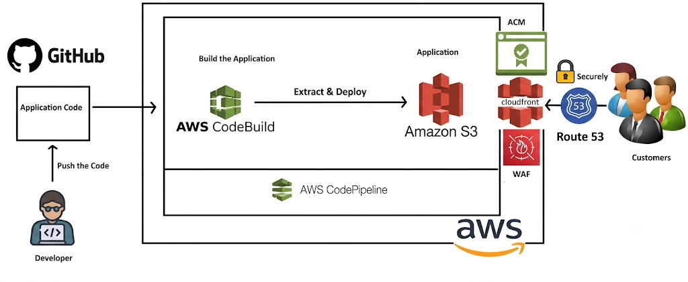

# Static Website Deployment on AWS

Deploy a static website from GitHub to a private Amazon S3 bucket with AWS CodePipeline and CodeBuild. Amazon CloudFront serves the site through Origin Access Control (OAC), while AWS WAF, ACM, and optionally Route 53 provide protection, HTTPS, and a custom domain.

## Architecture



**Request path:** visitors use the CloudFront URL or custom domain. Route 53 (optional) points the domain to CloudFront. CloudFront serves cached content over HTTPS, applies the attached WAF web ACL, and reads the private S3 origin through OAC.

**Deployment path:** a push to GitHub starts CodePipeline. Its Source stage fetches the repository, its Build stage runs CodeBuild, and its S3 Deploy stage extracts the build artifact into the website bucket. CodeDeploy is not part of this design.

## Before you start

- An AWS account with permission to create S3, CloudFront, ACM, WAF, CodeBuild, CodePipeline, IAM roles, and (optionally) Route 53 resources.
- A GitHub repository containing `index.html` at its root. This guide uses `swapnilshetgar/s3-project-with-codepipeline` and branch `main` from the supplied notes; substitute your own repository if needed.
- A public DNS domain if you want a custom domain. The supplied notes use `getuserinfo.site`.
- A globally unique S3 bucket name. The notes mention both `sapi-bucket-12345` and `sapi-bkt`; use the exact bucket name you actually created everywhere below.

> **Important:** CloudFront certificates must be requested or imported in **US East (N. Virginia), `us-east-1`**. Keep the CodeBuild project, CodePipeline, S3 bucket, and pipeline artifact bucket in the same AWS Region.

## 1. Create the S3 bucket

1. Open **Amazon S3 → Buckets → Create bucket**.
2. Enter a globally unique name, such as `sapi-bucket-12345` (if available).
3. Select your deployment Region.
4. Keep **Block all public access** enabled. Keep ACLs disabled / **Bucket owner enforced**.
5. Enable bucket versioning if you want easy recovery from overwritten site files, then create the bucket.

Use a regular S3 bucket origin in CloudFront. Do not enable public access or use the S3 website endpoint for this OAC design.

## 2. Create the CloudFront distribution

1. Open **CloudFront → Distributions → Create distribution**. If the console offers **Single website configuration**, choose it.
2. Set a distribution name such as `mydistro`.
3. For the origin type, select **Amazon S3** and browse to the bucket created in step 1. Select the bucket's regular S3 origin, not its static website endpoint.
4. Under origin access, choose **Origin access control settings (recommended)**. Create or select an OAC with **Sign requests (recommended)**. Keep the bucket private.
5. Set the default root object to `index.html` if the wizard offers this option. Otherwise, configure it after creation under **General → Settings → Edit**.
6. If you already have an issued ACM certificate for `getuserinfo.site`, add the domain as an alternate domain name and select that certificate. If not, finish the distribution first, then attach the certificate in step 5.
7. Choose **Redirect HTTP to HTTPS** for the viewer protocol policy and create the distribution.
8. Wait for the distribution status to become **Deployed**. Note the distribution ID and domain name (the supplied example is `d1p1fm39nnb0hf.cloudfront.net`; use your own distribution's domain).

### Allow CloudFront to read the private bucket

In **CloudFront → distribution → Origins**, edit the S3 origin and confirm the OAC is attached. Use the console's **Copy policy** action if it is available. In **S3 → bucket → Permissions → Bucket policy**, add the generated statement, or adapt this template. Replace both placeholders with your actual bucket and distribution ARN:

```json
{
  "Version": "2012-10-17",
  "Statement": [
    {
      "Sid": "AllowCloudFrontServicePrincipalReadOnly",
      "Effect": "Allow",
      "Principal": { "Service": "cloudfront.amazonaws.com" },
      "Action": "s3:GetObject",
      "Resource": "arn:aws:s3:::<BUCKET_NAME>/*",
      "Condition": {
        "StringEquals": {
          "AWS:SourceArn": "arn:aws:cloudfront::<AWS_ACCOUNT_ID>:distribution/<DISTRIBUTION_ID>"
        }
      }
    }
  ]
}
```

If the bucket already has a policy, add this statement to its existing `Statement` array rather than replacing other required statements. Do not make the bucket public.

## 3. Request and attach the TLS certificate

For a custom domain such as `getuserinfo.site`:

1. Switch the AWS console to **US East (N. Virginia), `us-east-1`**.
2. Open **AWS Certificate Manager (ACM) → Request certificate → Request a public certificate**.
3. Add the exact domain name you plan to use (for example `getuserinfo.site`). Add `www.getuserinfo.site` too if you will use that hostname.
4. Choose DNS validation. Create the validation CNAME record in Route 53 or with your DNS provider, then wait until the certificate status is **Issued**.
5. In CloudFront, edit the distribution settings. Add the same hostname under **Alternate domain names** and select the issued ACM certificate. Save and wait for the distribution to return to **Deployed**.

If the certificate was created in another Region, CloudFront will not offer it. Request/import the CloudFront certificate in `us-east-1`.

## 4. Create the CodeBuild project

1. Open **CodeBuild → Build projects → Create build project**.
2. Set the project name to `website`.
3. For **Source provider**, choose **CodePipeline** because CodePipeline will supply the repository source. Do not configure this project as an independent GitHub source project for this pipeline.
4. Choose a managed Linux image and a current supported standard runtime.
5. Create/select the CodeBuild service role. Allow it to write build logs and read/write the CodePipeline artifact bucket as required.
6. Configure the buildspec file as `buildspec.yml` at the repository root. Set artifacts to **CodePipeline**.
7. Create the project.

Add this `buildspec.yml` to the root of the GitHub repository for a plain HTML website:

```yaml
version: 0.2
phases:
  build:
    commands:
      - echo "Preparing static website files"
      - test -f index.html
artifacts:
  files:
    - '**/*'
  discard-paths: no
```

If the site needs compilation, add its install/build commands and set `artifacts.base-directory` to the generated output directory (for example, `dist`).

## 5. Create CodePipeline

1. Open **CodePipeline → Create pipeline**. Choose a name, such as `sapi-static-site-pipeline`.
2. For pipeline type, use the default recommended option. Create a new CodePipeline service role and artifact bucket, or select approved existing resources. Keep them in the same Region as the pipeline.
3. **Source stage:** select **GitHub (via GitHub App / CodeConnections)**. Create/select the connection and authorize the AWS managed GitHub App for the account/repository. Select repository `s3-project` (or `swapnilshetgar/s3-project-with-codepipeline`) and branch `main`.
4. **Build stage:** choose **AWS CodeBuild**, then select the `website` project from step 4. Confirm the build action receives the source artifact and returns a build output artifact.
5. **Deploy stage:** choose **Amazon S3**, select the exact website bucket from step 1, select the CodeBuild output artifact, and set **Extract file before deploy** to **Yes**. Do not set a public ACL.
6. Review and create the pipeline. The first execution should run Source → Build → Deploy.

The CodePipeline role needs permission to use the GitHub connection, start/read the named CodeBuild project, access its artifact bucket, and write objects to the website bucket. CodeBuild needs its service role for logs and pipeline artifacts. Letting the console create the initial service roles is a practical starting point; restrict their resource ARNs to the specific connection, project, artifact bucket, and destination bucket for production.

## 6. Verify the website

1. In CodePipeline, confirm the latest execution succeeds in all three stages.
2. Open `https://<YOUR_CLOUDFRONT_DOMAIN>/index.html` (the supplied example was `https://d1p1fm39nnb0hf.cloudfront.net/index.html`).
3. Also test `https://<YOUR_CLOUDFRONT_DOMAIN>/`. This should load `index.html` when the default root object is set.
4. Confirm the S3 bucket still blocks public access. Visitors should access the site through CloudFront.

## 7. Add AWS WAF (recommended)

1. Open **AWS WAF & Shield → Web ACLs → Create web ACL**.
2. Set the resource type/scope to protect **CloudFront distributions** (global scope; use `us-east-1` in CLI workflows).
3. Add AWS Managed Rules such as the Core Rule Set. Consider starting new rules in **Count** mode, reviewing metrics and sampled requests, then switching to Block after tuning.
4. Create the Web ACL and associate it with the CloudFront distribution. Wait for the distribution deployment to complete.

## 8. Point Route 53 to CloudFront (optional custom domain)

1. Confirm your domain's public hosted zone exists in **Route 53 → Hosted zones** and that the domain is delegated to the Route 53 name servers. If the domain is registered elsewhere, update its nameserver records at that registrar.
2. In the hosted zone, choose **Create record**. For the zone apex `getuserinfo.site`, create an **A** record, enable **Alias**, and select the CloudFront distribution as the alias target. Add an **AAAA Alias** record too if you want IPv6.
3. If using `www.getuserinfo.site`, create its own alias record to the same distribution and make sure the hostname is included in both the CloudFront alternate domain names and ACM certificate.
4. Wait for DNS propagation, then visit `https://getuserinfo.site/index.html`.

Route 53 alias records should point to CloudFront. Do not point the domain directly to the private S3 bucket.

## Troubleshooting

| Problem | What to check |
|---|---|
| GitHub repository list is empty | Confirm the CodeConnections GitHub App is installed for the right account and can access the repository. Refresh the list. The GitHub connection belongs in the Pipeline Source stage. |
| CodeBuild cannot find `index.html` | Confirm it is at the repository root, or set the buildspec artifact base directory to the framework's output folder. |
| Pipeline S3 deploy fails | Confirm the deploy bucket is correct, the Pipeline role can write to it, and **Extract file before deploy** is enabled. |
| CloudFront returns 403 | Confirm `index.html` exists at the bucket root, the CloudFront origin uses the regular S3 endpoint, the OAC is attached and signs requests, and the bucket policy's `AWS:SourceArn` matches this distribution. Check SSE-KMS key permissions if the object uses KMS encryption. |
| `/index.html` works but `/` fails | Set CloudFront **Default root object** to `index.html`. |
| Website still shows an old version | Wait for CloudFront deployment, then create an invalidation for `/` and `/index.html`, or use versioned asset filenames. |
| Certificate/domain error | ACM certificate must be **Issued** in `us-east-1`; its names must match CloudFront alternate domain names and the Route 53 record. |
| Custom domain does not resolve | Check hosted zone delegation, alias target, record name/type, and DNS propagation. |

## Clean up

To stop ongoing CloudFront charges, disable the distribution and wait for it to return to **Deployed**, then delete it. Remove the WAF association/Web ACL, empty and delete the S3 website and artifact buckets, delete the pipeline and CodeBuild project, and remove unused roles and connections. Keep any files, logs, or object versions you still need before deleting them.
